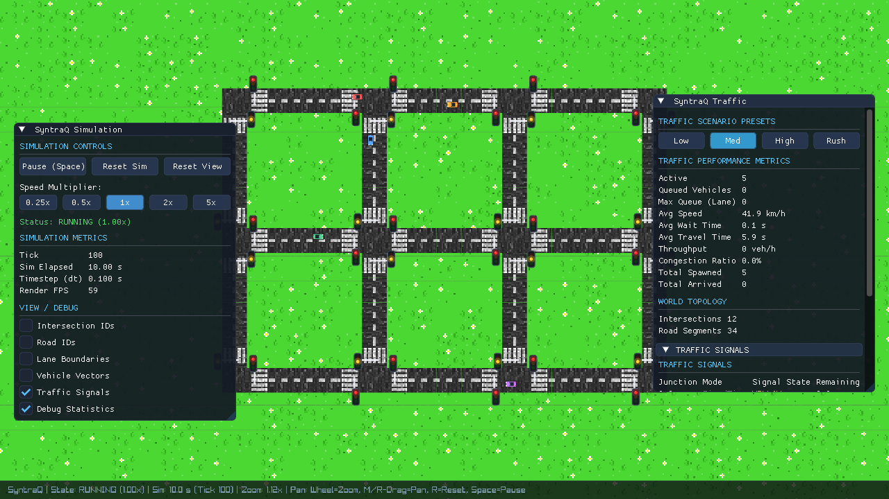

# SyntraQ: Real-time AI-driven Urban Traffic Simulation & Optimization

A research-oriented C++20 simulation platform that models urban traffic and evaluates AI-based traffic management strategies.



---

## Status

> <u>**Note:**</u> SyntraQ is a research-oriented project and is currently **under active development**. Some features may be experimental or incomplete.

| System / Feature | Description | Status |
|---|---|---|
| Core Engine & Simulation Loop | Deterministic fixed-timestep ($\Delta t = 0.10\,\text{s}$), pause/resume, speed presets | ✅ Complete |
| Road Network Model | Directed multigraph topology, lane management, speed limits, geometric transforms | ✅ Complete |
| Vehicle Kinematics & Behavior | Car-following model, emergency braking, queue formation, turn slowdowns, collision avoidance | ✅ Complete |
| Visual UI & Layout | Three-region layout (Simulation Controls, Viewport, Traffic Telemetry & Signals) | ✅ Complete |
| Fixed-Time Traffic Signals | Configurable cycle splits, green/yellow/all-red phases, multi-intersection coordination | ✅ Complete |
| Routing Engine | Graph pathfinding with Dijkstra and A*, customizable heuristics, weighted travel costs | ✅ Complete |
| Telemetry & Metrics Engine | Decoupled tracking: throughput, waiting times, queue lengths, average speed, congestion % | ✅ Complete |
| Experiments & Batch Pipeline | Headless execution, multi-seed evaluation, automated statistical aggregation, CSV exports | ✅ Complete |
| Analysis & Visualization | Automated Python pipeline producing Pandas summaries and Matplotlib comparative charts | ✅ Complete |
| Data Generation & Preprocessing | Structured 26-feature dataset extraction, dual-horizon lookahead targets, leakage-free splitting | ✅ Complete |
| Classical Prediction Models | Baseline & ensemble models (Linear, Ridge, RF, GBDT) with R²=0.88, sub-millisecond inference | ✅ Complete |
| PyTorch Neural Predictor | 3-layer MLP, PyTorch DataLoader & training loop, checkpointing, R²=0.89 | ✅ Complete |
| Adaptive & AI Signal Optimization | Reinforcement Learning & Neural Network adaptive traffic signal controllers | ⏳ Planned |

---

## Tech Stack

| Component      | Technology                     |
|----------------|--------------------------------|
| Core language  | C++20                          |
| Build system   | CMake 4.x + Ninja              |
| Rendering      | Raylib 6.0 (ARM64 MSVC)        |
| UI / Debug     | Dear ImGui + rlImGui           |
| Tests          | GoogleTest + CTest (131 tests) |
| CI             | GitHub Actions                 |
| Data Analysis  | Python 3 (Pandas, NumPy, Matplotlib) |
| Deep Learning  | PyTorch 2.x (CPU / CUDA)       |
| AI deployment  | ONNX Runtime (future)          |

---

## Prerequisites

- **Windows ARM64** (tested) or x64 / Linux
- **Visual Studio 2022** with MSVC ARM64 toolchain (or GCC 13+ / Clang 17+)
- **CMake ≥ 3.25**
- **Ninja**
- **Git**
- Raylib 6.0 SDK
- **Python ≥ 3.10** with `pandas` and `matplotlib` (for experiment analysis)

---

## Building

Open a **Developer Command Prompt for VS 2022 (ARM64)** and run:

```powershell
# Configure (Debug)
cmake -B build -G Ninja -DCMAKE_BUILD_TYPE=Debug

# Build
cmake --build build

# Run interactive simulation
.\build\bin\syntraq.exe
```

### Release build

```powershell
cmake -B build-rel -G Ninja -DCMAKE_BUILD_TYPE=Release
cmake --build build-rel
```

### Custom Raylib SDK path

```powershell
cmake -B build -G Ninja -DRAYLIB_SDK_DIR="C:/path/to/raylib"
```

---

## Running Headless & CLI Flags

The simulator can run headlessly without Raylib/ImGui initialization, making it suitable for scripted benchmarks and automated pipelines:

```powershell
# Run headless simulation for 120 seconds with seed 42 and High traffic
.\build\bin\syntraq.exe --headless --duration 120 --scenario high --seed 42 --csv summary.csv

# Available CLI options:
#   --headless, -h           Run without GUI/rendering
#   --duration, -d <seconds> Simulation duration in seconds
#   --seed <number>          Random seed for deterministic generation
#   --scenario, -s <preset>  Traffic scenario preset: low, med, high, rush
#   --csv <path>             Export run summary metrics to CSV
#   --csv-timeseries <path>  Export periodic snapshot time-series to CSV
#   --screenshot <path>      Capture screenshot at start and exit
#   --debug-overlays         Enable technical debug overlays
```

---

## Baseline Experiments & Analysis Pipeline

SyntraQ includes an automated experiment suite to establish empirical performance baselines:

```powershell
# Run batch experiments (evaluates fixed-time controller across Low, Med, High, Rush Hour across multiple seeds)
.\build\bin\syntraq_experiments.exe

# Process results and generate publication-quality comparison charts
python scripts/analyze_baseline.py
```

Generated charts are saved to `data/experiments/charts/`:
- `baseline_metrics_dashboard.png` (Comprehensive 4-panel overview)
- `speed_and_throughput.png`
- `waiting_and_travel_time.png`
- `queues_and_congestion.png`

---

## Running Tests

SyntraQ maintains a test suite across kinematics, signal state machines, pathfinding algorithms, queue dynamics, metrics tracking, and training data generation:

```powershell
cd build
ctest --output-on-failure
```

Or execute targeted test suites directly:

```powershell
.\build\bin\test_data_generation.exe
.\build\bin\test_traffic_behavior.exe
.\build\bin\test_metrics.exe
.\build\bin\test_routing.exe
.\build\bin\test_signals.exe
```

---

## Machine Learning Data Generation & Preprocessing

SyntraQ provides a complete, leakage-free pipeline for training traffic prediction models:

```powershell
# 1. Generate multi-scenario raw traffic dataset with 15s and 30s future ground-truth targets
.\build\bin\syntraq_generate_dataset.exe --runs 5 --duration 120 --interval 1.0 --output data/dataset/raw_traffic_data.csv

# 2. Preprocess, standardize, and perform run-level leakage-free train/validation/test split
python scripts/preprocess_dataset.py --input data/dataset/raw_traffic_data.csv --output-dir data/dataset/processed
```

Generated dataset artifacts:
- `data/dataset/processed/train.csv`, `val.csv`, `test.csv`
- `data/dataset/processed/dataset.npz` (Ready-to-load NumPy matrices for PyTorch/TensorFlow)
- `data/dataset/processed/metadata.json` (Feature definitions, scaler statistics, and run audit)
- Full methodology documented in [docs/data_generation_and_features.md](docs/data_generation_and_features.md)

---

## Machine Learning & Neural Traffic Prediction

SyntraQ provides both classical regression baselines and a PyTorch neural network to predict future queue lengths and congestion from 26 state telemetry features:

```powershell
# 1. Train and benchmark classical models (Linear Regression, Ridge, Random Forest, Gradient Boosting)
python scripts/train_prediction_model.py --target target_queue_15s --seed 42

# 2. Train and evaluate PyTorch TrafficMLP neural network (with DataLoader, checkpointing, and scheduler)
python scripts/train_pytorch_mlp.py --epochs 120 --batch-size 32 --lr 0.003
```

### Model Architecture (PyTorch TrafficMLP)

```
Input (26 features) --> Dense (64) --> ReLU --> Dense (32) --> ReLU --> Output (1 scalar)
```
- Total trainable parameters: **3,841**
- Checkpoint size: **20.3 KB** (30x smaller than tree ensemble bundles)

### Comprehensive Model Benchmark Results (+15s Future Queue Length)

| Model Architecture | Type | Val MAE | Val RMSE | Val R^2 | Test MAE | Test RMSE | Test R^2 | Max Error | Inference Latency |
| :--- | :--- | :---: | :---: | :---: | :---: | :---: | :---: | :---: | :---: |
| **Dummy (Mean)** | Baseline | 6.40 veh | 8.91 veh | -0.0004 | 5.94 veh | 7.80 veh | -0.0024 | 35.73 veh | 0.03 us |
| **Linear Regression** | Classical | 2.90 veh | 3.85 veh | 0.8135 | 2.92 veh | 3.83 veh | 0.7585 | 13.46 veh | 0.21 us |
| **Ridge Regression** | Classical | 2.90 veh | 3.85 veh | 0.8131 | 2.91 veh | 3.81 veh | 0.7612 | 12.93 veh | 0.11 us |
| **Random Forest** | Classical | 2.26 veh | 3.46 veh | 0.8494 | 2.15 veh | 3.09 veh | 0.8431 | 12.77 veh | 33.65 us |
| **Gradient Boosting** | Classical | 2.09 veh | 3.07 veh | 0.8812 | 1.90 veh | 2.72 veh | 0.8779 | 10.80 veh | 1.91 us |
| **PyTorch TrafficMLP (Best)** | **Neural Net** | **1.79 veh** | **2.40 veh** | **0.9272** | **1.75 veh** | **2.56 veh** | **0.8919** | **9.94 veh** | **2.45 us** |

### Artifacts & Reports
- **PyTorch Model Checkpoint**: `models/best_traffic_mlp.pt`
- **PyTorch Metrics JSON**: `models/mlp_evaluation_metrics.json`
- **Classical Model Bundle**: `models/best_traffic_predictor.joblib`
- **Classical Metrics JSON**: `models/evaluation_metrics.json`
- **Visual Diagnostics**: [docs/mlp_training_and_evaluation.png](docs/mlp_training_and_evaluation.png)
- **Detailed Evaluation & Trade-off Analysis**: [docs/mlp_evaluation_report.md](docs/mlp_evaluation_report.md)

---

## Project Structure

```
SyntraQ/
├── include/syntraq/
│   ├── core/          # Config and shared types (.hpp)
│   ├── world/         # Road network graph (Intersections & Roads) (.hpp)
│   ├── vehicles/      # Vehicle kinematics, car-following, and spawner (.hpp)
│   ├── signals/       # Traffic signals (Phases, Controllers) (.hpp)
│   ├── routing/       # Routing engine (Dijkstra, A*, Heuristics, Costs) (.hpp)
│   ├── metrics/       # Telemetry & ML dataset collectors (.hpp)
│   ├── simulation/    # Headless simulation loop & state (.hpp)
│   └── rendering/     # Raylib + ImGui renderer (.hpp)
├── src/
│   ├── core/          # Config implementation
│   ├── world/         # Road network implementation
│   ├── vehicles/      # Kinematics and queue formation systems
│   ├── signals/       # Traffic signal controllers
│   ├── routing/       # Dijkstra, A*, and graph generator
│   ├── metrics/       # Telemetry collector, ML data generator, CSV exporters
│   ├── simulation/    # Simulation loop & scenario management
│   ├── rendering/     # Renderer and three-panel UI layout
│   └── main.cpp       # CLI parsing and application entry point
├── experiments/       # Baseline experiments and batch dataset generator
├── scripts/           # Statistical analysis and ML preprocessing pipelines
├── tests/             # GoogleTest suites (131 tests across all subsystems)
├── benchmarks/        # Routing engine benchmarks (Dijkstra vs A*)
├── configs/           # Scenario JSON configurations
├── data/              # Experiment datasets, ML training data, and generated charts
├── assets/            # Fonts, textures (future)
├── models/            # Trained prediction models (joblib) & evaluation metrics (json)
└── docs/              # Layout screenshots, dataset specifications, and architecture docs
```

---

## Architecture Principles

1. `syntraq_core` (static lib) — Headless, zero graphics dependencies, 100% testable via unit tests and headless runners.
2. `syntraq_renderer` — All Raylib and ImGui rendering calls isolated here; consumes simulation state strictly read-only.
3. `syntraq_experiments` — Headless batch execution harness for multi-seed statistical evaluations.
4. `syntraq` — Lightweight CLI entry point coordinating configuration, simulation, and optional rendering.
5. Deterministic Simulation — Random seeds strictly govern vehicle routes, spawning intervals, and behavior.
6. Modular Routing Engine — Pathfinding isolated behind the `IRouteProvider` / `IRouter` abstraction (supporting A*, Dijkstra, and greedy heuristics).
7. Independent Telemetry — Performance metrics (`TrafficMetricsCollector`) compute statistics without rendering dependencies.

---

## Simulation Controls & UI Layout

### Three-Region Interface
- **Left Panel ("SyntraQ Simulation")**: Simulation controls (Play/Pause, Reset, Speed Presets), traffic scenario selector (Low, Med, High, Rush Hour), seed configuration, and road network statistics.
- **Center Viewport**: Real-time traffic rendering with dynamic camera controls and vehicle visualizations.
- **Right Panel ("SyntraQ Traffic")**: Live performance telemetry (Average Speed, Waiting Time, Queue Lengths, Throughput, Congestion Ratio) and live signal phase status for each junction.

### Camera Controls
- **Mouse Wheel**: Smooth zoom towards cursor position (0.25× – 4.0×).
- **Middle Mouse Drag** or **Right Mouse Drag**: Pan the viewport.
- **R Key** or **Reset View Button**: Frame and center the road network within the active viewport.

### Simulation Controls
- **Space** or **Pause / Resume Button**: Toggle simulation execution.
- **Reset Sim Button**: Resets simulation clock, vehicles, and network to $t=0$.
- **Speed Multipliers**: `0.25×`, `0.5×`, `1×`, `2×`, `5×` presets.

### Debug Visualizations (Toggleable)
- **Intersection IDs**: Technical ID badges on junction nodes.
- **Road IDs**: Segment ID labels centered along road links.
- **Lane Boundaries**: Visible lane boundary guidelines.
- **Vehicle Direction Vectors**: Forward heading vectors from vehicles.

### Fixed-Timestep Architecture
Simulation advancement is decoupled from rendering frame rate:
$$\text{Real elapsed time} \xrightarrow{} \text{Accumulator} \xrightarrow{} \text{Fixed timestep } (\Delta t = 0.10\,\text{s}) \xrightarrow{} \text{Simulation updates} \xrightarrow{} \text{Rendering}$$

Guarantees bit-identical, reproducible simulation progression regardless of display refresh rate or headless execution.

---

## License

This project uses the GNU GPL3.0 license. Refer to [LICENSE](LICENSE) for more details.
