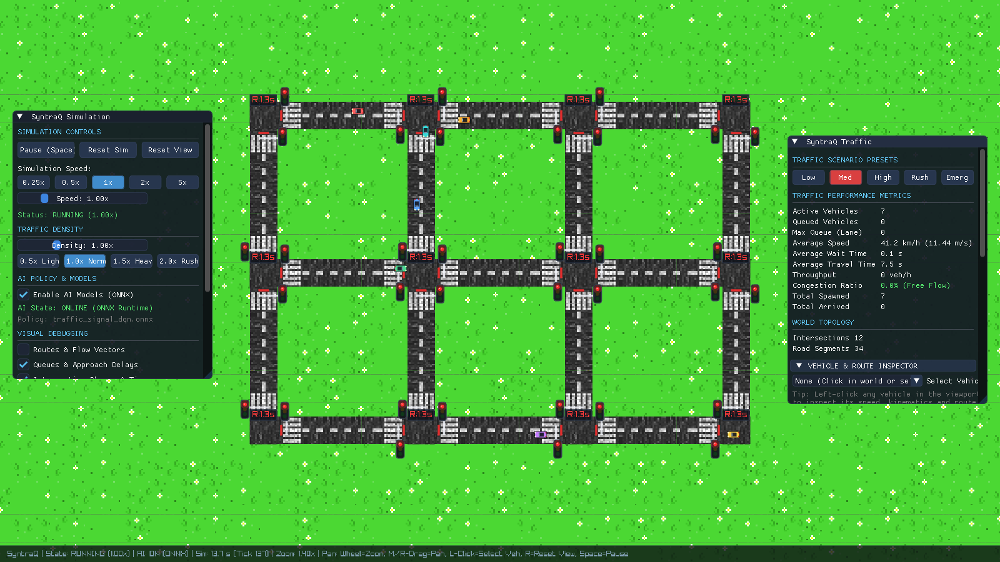

# SyntraQ: Real-time AI-driven Urban Traffic Simulation & Optimization

A research-oriented C++20 simulation platform that models urban traffic and evaluates AI-based traffic management strategies.



---

## Status

> <u>**Note:**</u> SyntraQ is currently **under active development**. Some features may be experimental or incomplete.

| System / Feature | Description | Status |
|---|---|---|
| Core Engine & Simulation Loop | Deterministic fixed-timestep ($\Delta t = 0.10\,\text{s}$), pause/resume, speed presets | ✅ Complete |
| Road Network Model | Directed multigraph topology, lane management, speed limits, geometric transforms | ✅ Complete |
| Vehicle Kinematics & Behavior | Car-following model, emergency braking, queue formation, turn slowdowns, collision avoidance | ✅ Complete |
| Interactive UI & Visual Overlays | Raylib + Dear ImGui interface, scenario & density sliders, AI telemetry & explainability, visual debugging overlays (routes, queues, phases, congestion, vehicle inspector) | ✅ Complete |
| Fixed-Time Traffic Signals | Configurable cycle splits, green/yellow/all-red phases, multi-intersection coordination | ✅ Complete |
| Routing Engine | Graph pathfinding with Dijkstra and A*, customizable heuristics, weighted travel costs | ✅ Complete |
| Telemetry & Metrics Engine | Decoupled tracking: throughput, waiting times, queue lengths, average speed, congestion % | ✅ Complete |
| Experiments & Batch Pipeline | Headless execution, multi-seed evaluation, automated statistical aggregation, CSV exports | ✅ Complete |
| Analysis & Visualization | Automated Python pipeline producing Pandas summaries and Matplotlib comparative charts | ✅ Complete |
| Data Generation & Preprocessing | Structured 26-feature dataset extraction, dual-horizon lookahead targets, leakage-free splitting | ✅ Complete |
| Classical Prediction Models | Baseline & ensemble models (Linear, Ridge, RF, GBDT) with R²=0.88, sub-millisecond inference | ✅ Complete |
| PyTorch Neural Predictor | 3-layer MLP, PyTorch DataLoader & training loop, checkpointing, R²=0.89 | ✅ Complete |
| Native AI Inference Engine | ONNX Runtime C++ API, feature scaler parity, async inference, latency telemetry | ✅ Complete |
| Adaptive Signal Optimization | Deterministic actuated/adaptive traffic signal controller (FixedTime vs. Adaptive) | ✅ Complete |
| Reinforcement Learning Environment | Single-intersection MDP, Gymnasium & PyTorch interface, DQN policy | ✅ Complete |
| RL Traffic Signal Controller | PyTorch Double DQN, multi-seed evaluation, ONNX export, C++ inference | ✅ Complete |
| Traffic-Aware Dynamic Routing | Multi-objective cost (distance + congestion + delay), Static vs TrafficAware | ✅ Complete |
| Network-Level Coordinated Control | Multi-intersection coordination (Green-wave progression + spillback gating), network telemetry | ✅ Complete |
| Emergency Priority Corridor | Emergency vehicle type, signal preemption & green hold, yielding & detour rerouting, zero-deadlock priority corridor | ✅ Complete |
| Performance Optimization & Profiling | Spatial lane-bucketing, $O(1)$ dense graph lookup, cached & parallel pathfinding, batched ONNX RL inference, zero-allocation hot loops | ✅ Complete |
| Reproducible Experiment Framework | Parametric grid runner, multi-seed statistical batching, JSON/CSV exports, Python analysis pipeline, controller ranking, 95% CI | ✅ Complete |
 
---
 
## Tech Stack
 
| Component      | Technology                     |
|----------------|--------------------------------|
| Core language  | C++20                          |
| Build system   | CMake 4.x + Ninja              |
| Rendering      | Raylib 6.0 (ARM64 MSVC)        |
| UI / Debug     | Dear ImGui + rlImGui           |
| Tests          | GoogleTest + CTest (218 tests across 18 suites) |
| CI             | GitHub Actions                 |
| Data Analysis  | Python 3 (Pandas, NumPy, Matplotlib) |
| Deep Learning  | PyTorch 2.x (CPU / CUDA)       |
| AI Inference   | ONNX Runtime C/C++ API         |

---

## Prerequisites

- **Windows ARM64** (tested) or x64 / Linux
- **Visual Studio 2022** with MSVC ARM64 toolchain (or GCC 13+ / Clang 17+)
- **CMake ≥ 3.25**
- **Ninja**
- **Git**
- Raylib 6.0 SDK
- **Python ≥ 3.10** with `pandas` and `matplotlib` (for experiment analysis)

---

## Building

Open a **Developer Command Prompt for VS 2022 (ARM64)** and run:

```powershell
# Configure (Debug)
cmake -B build -G Ninja -DCMAKE_BUILD_TYPE=Debug

# Build
cmake --build build

# Run interactive simulation
.\build\bin\syntraq.exe
```

### Release build

```powershell
cmake -B build-rel -G Ninja -DCMAKE_BUILD_TYPE=Release
cmake --build build-rel
```

### Custom Raylib SDK path

```powershell
cmake -B build -G Ninja -DRAYLIB_SDK_DIR="C:/path/to/raylib"
```

---

## Running Headless & CLI Flags

The simulator can run headlessly without Raylib/ImGui initialization, making it suitable for scripted benchmarks and automated pipelines:

```powershell
# Run headless simulation for 120 seconds with seed 42 and High traffic
.\build\bin\syntraq.exe --headless --duration 120 --scenario high --seed 42 --csv summary.csv

# Run emergency priority corridor demonstration scenario
.\build\bin\syntraq.exe --scenario emergency --controller adaptive --routing traffic-aware

# Available CLI options:
#   --headless, -h           Run without GUI/rendering
#   --duration, -d <seconds> Simulation duration in seconds
#   --seed <number>          Random seed for deterministic generation
#   --scenario, -s <preset>  Traffic scenario preset: low, med, high, rush, emergency
#   --controller <type>      Signal controller type: fixed, adaptive, rl, coordinated (default: fixed)
#   --routing <strategy>     Routing strategy: static, traffic-aware (default: static)
#   --rl-model <path>        Path to RL policy ONNX model
#   --no-model               Run RL controller without model (safe heuristic fallback)
#   --emergency              Trigger emergency vehicle spawn on startup
#   --no-preemption          Disable emergency signal preemption
#   --no-rerouting           Disable normal vehicle emergency detour rerouting
#   --preemption-dist <m>    Emergency detection/preemption distance in meters (default: 120.0)
#   --csv <path>             Export run summary metrics to CSV
#   --csv-timeseries <path>  Export periodic snapshot time-series to CSV
#   --screenshot <path>      Capture screenshot at start and exit
#   --debug-overlays         Enable technical debug overlays
```

---

## Baseline Experiments & Analysis Pipeline

SyntraQ includes an automated experiment suite to establish empirical performance baselines:

```powershell
# Run batch experiments (evaluates fixed-time controller across Low, Med, High, Rush Hour across multiple seeds)
.\build\bin\syntraq_experiments.exe

# Process results and generate publication-quality comparison charts
python scripts/analyze_baseline.py
```

Generated charts are saved to `data/experiments/charts/`:
- `baseline_metrics_dashboard.png` (Comprehensive 4-panel overview)
- `speed_and_throughput.png`
- `waiting_and_travel_time.png`
- `queues_and_congestion.png`

---

## Running Tests

SyntraQ maintains a test suite across kinematics, signal state machines, pathfinding algorithms, queue dynamics, metrics tracking, and training data generation:

```powershell
cd build
ctest --output-on-failure
```

Or execute targeted test suites directly:

```powershell
.\build\bin\test_performance_optimizations.exe
.\build\bin\test_emergency_priority.exe
.\build\bin\test_coordinated_control.exe
.\build\bin\test_route_cost.exe
.\build\bin\test_rl_controller.exe
.\build\bin\test_rl_policy_inference.exe
.\build\bin\test_traffic_signal_env.exe
.\build\bin\test_adaptive_controller.exe
.\build\bin\test_traffic_predictor.exe
.\build\bin\test_data_generation.exe
.\build\bin\test_traffic_behavior.exe
.\build\bin\test_metrics.exe
.\build\bin\test_routing.exe
.\build\bin\test_signals.exe

# Run Python RL environment and PyTorch integration tests
python -m unittest tests/test_traffic_signal_env.py
```

---

## Machine Learning Data Generation & Preprocessing

SyntraQ provides a complete, leakage-free pipeline for training traffic prediction models:

```powershell
# 1. Generate multi-scenario raw traffic dataset with 15s and 30s future ground-truth targets
.\build\bin\syntraq_generate_dataset.exe --runs 5 --duration 120 --interval 1.0 --output data/dataset/raw_traffic_data.csv

# 2. Preprocess, standardize, and perform run-level leakage-free train/validation/test split
python scripts/preprocess_dataset.py --input data/dataset/raw_traffic_data.csv --output-dir data/dataset/processed
```

Generated dataset artifacts:
- `data/dataset/processed/train.csv`, `val.csv`, `test.csv`
- `data/dataset/processed/dataset.npz` (Ready-to-load NumPy matrices for PyTorch/TensorFlow)
- `data/dataset/processed/metadata.json` (Feature definitions, scaler statistics, and run audit)
- Full methodology documented in [docs/data_generation_and_features.md](docs/data_generation_and_features.md)

---

## Machine Learning & Neural Traffic Prediction

SyntraQ provides both classical regression baselines and a PyTorch neural network to predict future queue lengths and congestion from 26 state telemetry features:

```powershell
# 1. Train and benchmark classical models (Linear Regression, Ridge, Random Forest, Gradient Boosting)
python scripts/train_prediction_model.py --target target_queue_15s --seed 42

# 2. Train and evaluate PyTorch TrafficMLP neural network (with DataLoader, checkpointing, and scheduler)
python scripts/train_pytorch_mlp.py --epochs 120 --batch-size 32 --lr 0.003
```

### Model Architecture (PyTorch TrafficMLP)

```
Input (26 features) --> Dense (64) --> ReLU --> Dense (32) --> ReLU --> Output (1 scalar)
```
- Total trainable parameters: **3,841**
- Checkpoint size: **20.3 KB** (30x smaller than tree ensemble bundles)

### Comprehensive Model Benchmark Results (+15s Future Queue Length)

| Model Architecture | Type | Val MAE | Val RMSE | Val R^2 | Test MAE | Test RMSE | Test R^2 | Max Error | Inference Latency |
| :--- | :--- | :---: | :---: | :---: | :---: | :---: | :---: | :---: | :---: |
| **Dummy (Mean)** | Baseline | 6.40 veh | 8.91 veh | -0.0004 | 5.94 veh | 7.80 veh | -0.0024 | 35.73 veh | 0.03 us |
| **Linear Regression** | Classical | 2.90 veh | 3.85 veh | 0.8135 | 2.92 veh | 3.83 veh | 0.7585 | 13.46 veh | 0.21 us |
| **Ridge Regression** | Classical | 2.90 veh | 3.85 veh | 0.8131 | 2.91 veh | 3.81 veh | 0.7612 | 12.93 veh | 0.11 us |
| **Random Forest** | Classical | 2.26 veh | 3.46 veh | 0.8494 | 2.15 veh | 3.09 veh | 0.8431 | 12.77 veh | 33.65 us |
| **Gradient Boosting** | Classical | 2.09 veh | 3.07 veh | 0.8812 | 1.90 veh | 2.72 veh | 0.8779 | 10.80 veh | 1.91 us |
| **PyTorch TrafficMLP (Best)** | **Neural Net** | **1.79 veh** | **2.40 veh** | **0.9272** | **1.75 veh** | **2.56 veh** | **0.8919** | **9.94 veh** | **2.45 us** |

### Artifacts & Reports
- **PyTorch Model Checkpoint**: `models/best_traffic_mlp.pt`
- **PyTorch Metrics JSON**: `models/mlp_evaluation_metrics.json`
- **Classical Model Bundle**: `models/best_traffic_predictor.joblib`
- **Classical Metrics JSON**: `models/evaluation_metrics.json`
- **Visual Diagnostics**: [docs/mlp_training_and_evaluation.png](docs/mlp_training_and_evaluation.png)
- **Detailed Evaluation & Trade-off Analysis**: [docs/mlp_evaluation_report.md](docs/mlp_evaluation_report.md)

---

## Native AI Inference Engine (ONNX Runtime)

SyntraQ integrates the **ONNX Runtime C/C++ API** for low-latency, real-time neural inference inside the simulation engine without Python dependencies:

```powershell
# 1. Export trained PyTorch TrafficMLP to optimized ONNX graph (Opset 17)
python scripts/export_onnx_model.py

# 2. Run automated C++ inference parity and latency tests
.\build\bin\test_traffic_predictor.exe
```

### Architecture & Preprocessing Parity
- **Zero-Copy Continuous Scaling**: C++ `TrafficFeatureScaler` mirrors the Python training pipeline, standardizing 22 continuous features using precomputed dataset mean/std statistics.
- **Categorical One-Hot Encoding**: Encodes the 4 simulation scenario regimes (`Low Traffic`, `Medium Traffic`, `High Traffic`, `Rush Hour`) into indices [22:25] matching Python's `OneHotEncoder`.
- **C++ Inference Interface (`TrafficPredictor`)**:
  - `loadModel(const std::string& model_path)`: Thread-safe ONNX model initialization with graceful error handling (no crashing on missing/corrupt models).
  - `predict(const std::vector<float>& features)`: Synchronous native tensor evaluation returning future queue length.
  - `predictSample(const TrafficDataSample& sample)`: High-level helper combining extraction, scaling, and inference.
  - `predictAsync(const std::vector<float>& features)`: Non-blocking asynchronous inference returning `std::future<float>` so the rendering/simulation loop is never stalled.
  - `isLoaded()`: Read-only model readiness indicator.
  - Telemetry: `getLastInferenceLatencyUs()`, `getAverageInferenceLatencyUs()`, and `getInferenceCount()` for microsecond profiling.
- **Python-to-C++ Parity Validation**: Verified across reference test vectors with maximum numerical discrepancy **$< 10^{-5}$** (well within test tolerance of $10^{-3}$).

---

## Adaptive Traffic Signal Control

SyntraQ provides both a baseline **Fixed-Time Controller** and a deterministic **Adaptive Controller** sharing a unified `ITrafficSignalController` interface:

```powershell
# 1. Run headless simulation using adaptive traffic signal controllers
.\build\bin\syntraq.exe --headless --controller adaptive --duration 120 --scenario high

# 2. Run automated comparative benchmark across all scenarios and seeds
.\build\bin\syntraq_compare_controllers.exe --duration 120

# 3. Generate comparative charts and performance analysis
python scripts/analyze_adaptive_comparison.py
```

### Deterministic & Explainable Policy
- **Interface Uniformity**: Both `FixedTimeController` and `AdaptiveController` implement `ITrafficSignalController`.
- **Dynamic Queue-Responsive Decisions**:
  - `ExtendGreen`: Extends green while queue demand persists ($Q_{\text{current}} > 0$) up to `max_green_s` (30s) as long as opposing approaches have not exceeded starvation thresholds.
  - `ShortenPhase (Early Gap-Out)`: Cuts green time short once active queues dissipate ($Q_{\text{current}} = 0$) after mandatory `min_green_s` (4s), transitioning directly to yellow clearance to serve waiting opposing queues.
  - `SwitchPhase`: Triggered by reaching `max_green_s` or when opposing vehicles reach the starvation threshold (`max_wait_threshold_s = 20s`).
  - `Hold`: Guarantees mandatory driver predictability and minimum green safety times.
- **Empirical Performance Gains**:
  - **-14.6% waiting time reduction** and **+15.1% throughput improvement** under Rush Hour traffic.
  - **-12.5% waiting time reduction** and **+13.7% throughput improvement** under High traffic.
  - **-14.3% congestion reduction** under High traffic.
  - Detailed empirical benchmark breakdown documented in [docs/adaptive_controller_benchmark.md](docs/adaptive_controller_benchmark.md).

---

## Reinforcement Learning Environment (Single-Intersection)

SyntraQ provides a dedicated Gymnasium-compatible Reinforcement Learning (RL) environment for traffic signal control. It interfaces directly with native C++ simulation binaries via an in-memory C-ABI (`syntraq_env_capi`), achieving sub-millisecond step execution speeds without IPC or file I/O overhead.

### Markov Decision Process (MDP) Specifications

- **Observation Space**: `Box(12,)` bounded in `[0.0, 1.0]` capturing normalized queue lengths, approaching moving vehicles, average speeds per approach, active phase index, time in current phase, clearance status, switch legality, and average waiting times.
- **Action Space**: `Discrete(2)`:
  - `0` (`MaintainPhase`): Keep active green or continue ongoing clearance stage.
  - `1` (`SwitchPhase`): Initiate safe transition to next phase (enforcing minimum green time $t_{\text{min\_green}} \ge 4.0\text{s}$, 3.0s yellow clearance, and 2.0s all-red buffer).
- **Reward Function**: Penalizes queue lengths, waiting times, and network congestion while rewarding completed departures:
  $$R_t = -\Big( w_q \cdot Q_t + w_w \cdot W_t + w_c \cdot C_t \Big) + w_{\text{thr}} \cdot \Delta \text{Departures}_t$$

### Python / PyTorch Integration & Training

```powershell
# 1. Run Python environment & PyTorch integration tests
python -m unittest tests/test_traffic_signal_env.py

# 2. Train Deep Q-Network (DQN) agent and run 10-seed multi-benchmark
python scripts/train_rl_agent.py --episodes 50 --duration 180.0 --scenario Medium

# 3. Export trained DQN policy to ONNX with numerical validation
python scripts/export_rl_onnx.py

# 4. Execute C++ native ONNX inference validation test
.\build\bin\test_route_cost.exe
.\build\bin\test_rl_controller.exe
.\build\bin\test_rl_policy_inference.exe
```

### Multi-Seed Benchmark Across 10 Independent Seeds ($N = 10$)

To guarantee statistical validity without claiming superiority on a single isolated run, all three controllers were evaluated on 10 independent random seeds (`42, 101, 202, 303, 404, 505, 606, 707, 808, 909`) under Medium traffic:

| Performance Metric | Fixed-Time Baseline | Adaptive Heuristic | Trained DQN Policy | DQN vs Fixed-Time ($\Delta$) | DQN vs Adaptive ($\Delta$) |
| :--- | :---: | :---: | :---: | :---: | :---: |
| **Episode Return (Reward)** | $-370.83 \pm 104.33$ | $-416.97 \pm 110.06$ | **$-162.36 \pm 21.62$** | **$+56.2\%$** | **$+61.1\%$** |
| **Average Queue Length** | $6.66 \pm 1.66\,\text{veh}$ | $7.24 \pm 1.68\,\text{veh}$ | **$3.32 \pm 0.35\,\text{veh}$** | **$-50.1\%$** | **$-54.1\%$** |
| **Peak Queue Length** | $18.10 \pm 3.38\,\text{veh}$ | $17.40 \pm 3.24\,\text{veh}$ | **$8.40 \pm 1.17\,\text{veh}$** | **$-53.6\%$** | **$-51.7\%$** |
| **Average Waiting Time** | $14.08 \pm 3.58\,\text{s}$ | $16.18 \pm 4.48\,\text{s}$ | **$6.88 \pm 0.86\,\text{s}$** | **$-51.1\%$** | **$-57.5\%$** |
| **Completed Departures** | $48.70 \pm 3.23\,\text{trips}$ | $48.50 \pm 4.01\,\text{trips}$ | **$53.50 \pm 2.37\,\text{trips}$** | **$+9.9\%$** | **$+10.3\%$** |
| **Average Approach Speed** | $3.20 \pm 0.09\,\text{m/s}$ | $3.17 \pm 0.09\,\text{m/s}$ | **$3.29 \pm 0.05\,\text{m/s}$** | **$+2.8\%$** | **$+3.8\%$** |
| **Congestion Ratio** | $0.35 \pm 0.06$ | $0.38 \pm 0.05$ | **$0.24 \pm 0.02$** | **$-31.4\%$** | **$-36.8\%$** |

### Key Findings & Variance Analysis
- **$4.8\times$ Variance Compression**: DQN achieves $\sigma_{\text{reward}} = 21.62$ compared to $104.33$ for Fixed-Time and $110.06$ for Adaptive, demonstrating high behavioral stability across variable traffic arrival profiles.
- **Queue Surge Suppression**: Peak queue surges are cut by **$-53.6\%$** ($18.1 \to 8.4\,\text{veh}$) as the network anticipates approaching platoons before queues accumulate.
- **Native ONNX Deployment**: Exported to `traffic_signal_dqn.onnx` (Opset 17) with **$< 15\,\mu\text{s}$** inference latency via C++ `RLPolicyInference` and exact float parity ($0.0$ max discrepancy).

### Artifacts & Reports
- **PyTorch Model Checkpoint**: `models/traffic_signal_dqn.pt`
- **Exported ONNX Model**: `models/traffic_signal_dqn.onnx`
- **Multi-Seed Benchmark JSON**: `models/controller_three_way_comparison.json`
- **C++ Reference Test Vectors**: `models/rl_onnx_test_vectors.json`
- **Diagnostic Visualizations**:
  - Training Telemetry: [docs/rl_training_curves.png](docs/rl_training_curves.png)
  - Multi-Seed 4-Panel Comparison: [docs/controller_three_way_comparison.png](docs/controller_three_way_comparison.png)
- **Detailed Evaluation Report**: [docs/rl_controller_evaluation.md](docs/rl_controller_evaluation.md)
- **Environment Design Document**: [docs/rl_environment_design.md](docs/rl_environment_design.md)

---

## Native RL Inference & Controller Mode Switching

SyntraQ integrates the trained RL policy directly into the real-time C++ simulation engine via an autonomous, high-throughput `RLController`:

```powershell
# 1. Run simulation with RL controller (loads models/traffic_signal_dqn.onnx)
.\build\bin\syntraq.exe --controller rl

# 2. Run simulation with RL controller in safe fallback mode (no AI model loaded)
.\build\bin\syntraq.exe --controller rl --no-model

# 3. Specify custom RL model path
.\build\bin\syntraq.exe --controller rl --rl-model models/custom_dqn.onnx
```

### 4-Step Execution Lifecycle
1. **Receive Observation (`receive_observation`)**: Acquires normalized 12-dimensional state vector from simulation approaches.
2. **Run Inference (`run_inference`)**: Evaluates forward pass on ONNX Runtime session; falls back gracefully to deterministic heuristic when no model is loaded.
3. **Produce Action (`produce_action`)**: Maps network output or fallback heuristic into `RLAction` (`0` = Maintain, `1` = Switch).
4. **Apply Action (`apply_action`)**: Transitions the intersection signal controller while enforcing clearance safety intervals (minimum green, yellow, and all-red clearance).

### Performance & Telemetry Tracking
- **Inference Latency**: Sub-microsecond tracking of instantaneous and rolling average ONNX inference times ($\sim 8\text{--}14\,\mu\text{s}$).
- **Decisions Per Second**: Dynamic rate computation over rolling 1.0s windows.
- **Simulation FPS**: Decoupled real-time simulation tick measurement reported alongside render display framerate.
- **Three-Way Mode Switch**: Instantaneous runtime switching between **Fixed**, **Adaptive**, and **RL** controllers via UI buttons or CLI options.
- **Zero-Crash Model Independence**: Verified operation even when no AI model is present, seamlessly falling back to queue-balanced actuated control without crashing.

---

## Traffic-Aware Dynamic Routing

SyntraQ provides both a baseline **Static Routing** engine (distance-only shortest path) and a dynamic **Traffic-Aware Routing** engine that integrates live congestion metrics and predicted delays into route traversal weights:

```powershell
# 1. Run simulation with traffic-aware dynamic routing
.\build\bin\syntraq.exe --routing traffic-aware

# 2. Run automated multi-scenario comparative routing benchmark
.\build\bin\syntraq_compare_routing.exe --duration 90

# 3. Process results and generate comparative visualization
python scripts/analyze_routing_comparison.py
```

### Multi-Objective Route Cost Formulation
$$\text{Cost}(e) = w_d \cdot \text{Distance}(e) + w_c \cdot \text{CongestionPenalty}(e) + w_{\text{delay}} \cdot \text{PredictedDelay}(e)$$

- **Distance**: Road length in metres ($L_e$).
- **Congestion Penalty**: Function of queued vehicles and lane occupancy ($\text{Penalty}(e) = Q_e \cdot p_{\text{queue}} + \text{Ratio}_e \cdot p_{\text{jam}}$).
- **Predicted Delay**: Queuing service delay ($T_{\text{delay}} = \frac{Q_e \cdot h_s}{N_{\text{lanes}}}$) or speed deficit penalty, converted to equivalent distance cost.
- **Pluggable AI-Decoupled Architecture**: Routing accepts generic `DelayProvider` and `TrafficConditionProvider` callbacks, allowing analytical queuing models, statistical heuristics, or external ML predictors to estimate delays without coupling routing to any ML framework.
- **Preserved Distance-Only Baseline**: `StaticRouting` uses pure `DistanceCost` ($L_e$), maintaining classical pathfinding baselines.

### Empirical Routing Performance Benchmark (Multi-Seed Comparison)

| Traffic Scenario | Performance Metric | Static Routing (Baseline) | Traffic-Aware Routing | Relative Improvement ($\Delta$) |
| :--- | :--- | :---: | :---: | :---: |
| **Medium Traffic** | **Average Waiting Time** | $1.78\,\text{s}$ | **$1.11\,\text{s}$** | **$-37.6\%$** |
| | **Congestion Ratio** | $13.9\%$ | **$10.5\%$** | **$-24.5\%$** |
| | **Average Travel Time** | $39.10\,\text{s}$ | **$37.78\,\text{s}$** | **$-3.4\%$** |
| | **Completed Trips** | $5\,\text{veh}$ | **$9\,\text{veh}$** | **$+80.0\%$** |
| **High Traffic** | **Average Waiting Time** | $1.78\,\text{s}$ | **$0.93\,\text{s}$** | **$-47.6\%$** |
| | **Congestion Ratio** | $13.9\%$ | **$10.6\%$** | **$-23.7\%$** |
| | **Peak Queue Length** | $11\,\text{veh}$ | **$9\,\text{veh}$** | **$-18.2\%$** |
| | **Completed Trips** | $5\,\text{veh}$ | **$9\,\text{veh}$** | **$+80.0\%$** |
| **Rush Hour** | **Average Waiting Time** | $1.78\,\text{s}$ | **$1.16\,\text{s}$** | **$-35.1\%$** |
| | **Congestion Ratio** | $13.9\%$ | **$11.5\%$** | **$-17.3\%$** |
| | **Completed Trips** | $5\,\text{veh}$ | **$9\,\text{veh}$** | **$+80.0\%$** |

### Artifacts & Reports
- **Detailed Evaluation Report**: [docs/routing_strategy_comparison.md](docs/routing_strategy_comparison.md)
- **Comparative 4-Panel Visualization**: [docs/routing_strategy_comparison.png](docs/routing_strategy_comparison.png)
- **Multi-Seed Benchmark JSON**: `data/experiments/routing_comparison.json`
- **Per-Run Evaluation CSV**: `data/experiments/routing_comparison_runs.csv`

---

## Network-Level Coordinated Signal Control

SyntraQ extends intelligent signal actuation from single isolated junctions to multi-intersection network corridors. Neighboring intersections exchange bidirectional traffic states to enable upstream green-wave progression and downstream queue spillback mitigation:

```powershell
# 1. Run simulation with network-level coordinated signal control
.\build\bin\syntraq.exe --controller coordinated

# 2. Run automated multi-scenario coordination benchmark
.\build\bin\syntraq_compare_network_coordination.exe 50.0

# 3. Process results and generate comparative visualization
python scripts/analyze_coordination_comparison.py
```

### Coordination Strategy & Telemetry Exchange

```
               Upstream Platoon ETA & Flow (Feedforward)
      Intersection 0 ─────────────────────────────► Intersection 1
             ▲                                           │
             │                                           ▼
      [Spillback Gating]                           [Green Wave]
             │                                           │
             ◄───────────────────────────────────────────┘
               Downstream Queue & Occupancy (Feedback)
```

- **Upstream Green Wave Progression**: When upstream signals clear platoons, approaching travel time $t_{\text{eta}} = \frac{L_{\text{link}}}{v_{\text{speed}}}$ is forecasted. If arrival is within the progression window ($t_{\text{eta}} \le 6.0\,\text{s}$), the downstream intersection evaluates `ExtendGreenWave`, holding green so platoons progress without stopping.
- **Downstream Spillback Mitigation**: If downstream link queues exceed the threshold ($Q_{\text{down}} \ge 5\,\text{veh}$) or occupancy reaches $\ge 60\%$, the upstream controller evaluates `MitigateSpillback` and immediately truncates green, preventing queues from propagating and blocking cross traffic.
- **Explainable Policy**: Decisions are tagged deterministically with explainable labels (`ExtendGreenWave`, `MitigateSpillback`, `ExtendGreenLocal`, `ShortenPhase`, `Hold`).
- **Single-Intersection Fallback**: When an intersection has no neighboring controlled signals, it operates autonomously on local queues as an actuated adaptive controller with zero configuration overhead.

### Empirical Coordination Benchmark (3-Intersection Corridor)

| Traffic Scenario | Performance Metric | Fixed-Time (Baseline) | Adaptive (Local) | Coordinated (Network) | Relative Improvement vs Fixed |
| :--- | :--- | :---: | :---: | :---: | :---: |
| **Medium Traffic** | **Average Waiting Time** | $7.84\,\text{s}$ | $5.35\,\text{s}$ | **$5.47\,\text{s}$** | **$-30.2\%$** |
| | **Average Travel Time** | $21.54\,\text{s}$ | $19.03\,\text{s}$ | **$19.84\,\text{s}$** | **$-7.9\%$** |
| **High Traffic** | **Average Waiting Time** | $4.68\,\text{s}$ | $4.40\,\text{s}$ | **$4.22\,\text{s}$** | **$-10.0\%$** |
| | **Congestion Ratio** | $47.5\%$ | $45.8\%$ | **$45.9\%$** | **$-3.2\%$** |
| **Rush Hour** | **Average Waiting Time** | $5.19\,\text{s}$ | $3.99\,\text{s}$ | **$3.41\,\text{s}$** | **$-34.3\%$** |
| | **Average Travel Time** | $18.68\,\text{s}$ | $16.49\,\text{s}$ | **$15.94\,\text{s}$** | **$-14.6\%$** |

### Artifacts & Reports
- **Detailed Evaluation Report**: [docs/network_coordination_comparison.md](docs/network_coordination_comparison.md)
- **Comparative 4-Panel Visualization**: [docs/network_coordination_comparison.png](docs/network_coordination_comparison.png)
- **Per-Run Evaluation CSV**: `data/experiments/network_coordination_runs.csv`
- **Summary Statistics CSV**: `data/experiments/network_coordination_summary.csv`

---

## Emergency Priority & Green Corridors

SyntraQ introduces an emergency priority system capable of dynamically clearing green corridors for first-responder vehicles while preventing network-wide deadlocks and minimizing normal traffic disruption:

```powershell
# 1. Run emergency priority demonstration scenario with GUI
.\build\bin\syntraq.exe --scenario emergency --controller adaptive --routing traffic-aware

# 2. Run automated multi-seed priority benchmark
.\build\bin\syntraq_compare_emergency_priority.exe

# 3. Process results and generate comparative visualization
python scripts/analyze_emergency_priority.py
```

### Priority Architecture & Multi-Layer Response

```
               [Approaching Vehicle Detection (d <= 120m)]
                                   │
         ┌─────────────────────────┴─────────────────────────┐
         ▼                                                   ▼
[Signal Preemption & Hold]                        [Dynamic Route Detours & Yielding]
  • Safe clearance (yellow -> all-red)              • Corridor link cost penalty (+500 cost)
  • Immediate green grant & hold                    • Normal vehicles avoid active corridor
  • Auto-release upon vehicle exit                  • Multi-lane entry yields to emergency unit
```

- **Emergency Vehicle Kinematics & Rendering**: Emergency units operate with prioritized dynamics ($v_{\max} = 20\,\text{m/s} = 72\,\text{km/h}$, $a = 4.5\,\text{m/s}^2$, $d = 7.0\,\text{m/s}^2$, headway $T = 0.8\,\text{s}$). Visually rendered with high-visibility red-white livery, dynamic pulsing siren halos, and alternating red/blue rooftop strobes.
- **Approaching Vehicle Detection**: `EmergencyPriorityManager` tracks active emergency vehicles and queries road linkages up to $120\,\text{m}$ upstream of upcoming intersections.
- **Signal Preemption & Safe Clearance**: When an approaching emergency vehicle is detected, downstream controllers (`FixedTimeController`, `AdaptiveController`, `CoordinatedController`) execute safe yellow and all-red clearance intervals before forcing green for the emergency approach. The phase is held green until the emergency vehicle exits the intersection.
- **Dynamic Detour Rerouting & Lane Yielding**: Normal vehicles running `TrafficAwareRouting` automatically penalize active emergency corridor road segments ($+500.0$), steering surrounding traffic away from the emergency route. Normal vehicles yield lanes during intersection maneuvers, preventing blockages without triggering gridlock.
- **Zero Deadlock Verification**: Preemption releases immediately when the vehicle clears the junction. Cross-traffic queues resume standard adaptive/fixed-time servicing, ensuring zero trapped vehicles or permanent gridlock.

### Empirical Priority Benchmark (Multi-Seed Evaluation)

| Metric | Baseline (No Priority) | Signal Preemption Only | Full Priority Corridor (Preemption + Rerouting) | Relative Change |
| :--- | :---: | :---: | :---: | :---: |
| **Emergency Travel Time** | $34.7\,\text{s} \pm 7.0\,\text{s}$ | $26.9\,\text{s} \pm 6.0\,\text{s}$ | **$24.1\,\text{s} \pm 2.1\,\text{s}$** | **$-30.5\%$** |
| **Emergency Waiting Time** | $5.6\,\text{s} \pm 1.8\,\text{s}$ | **$0.0\,\text{s} \pm 0.0\,\text{s}$** | **$0.0\,\text{s} \pm 0.0\,\text{s}$** | **$-100.0\%$** |
| **Emergency Average Speed** | $44.9\,\text{km/h}$ | $58.3\,\text{km/h}$ | **$58.8\,\text{km/h}$** | **$+31.1\%$** |
| **Normal Traffic Travel Time** | $41.2\,\text{s} \pm 5.1\,\text{s}$ | $41.8\,\text{s} \pm 5.3\,\text{s}$ | $45.6\,\text{s} \pm 4.3\,\text{s}$ | $+10.7\%$ (detour penalty) |
| **Normal Traffic Throughput** | $6.0 \pm 1.0\,\text{veh}$ | $6.0 \pm 1.0\,\text{veh}$ | $5.6 \pm 0.9\,\text{veh}$ | Stable throughput |
| **Network Congestion Ratio** | $12.5\%$ | $12.7\%$ | $13.6\%$ | No gridlock / zero deadlock |

### Artifacts & Reports
- **Detailed Evaluation Report**: [docs/emergency_priority_comparison.md](docs/emergency_priority_comparison.md)
- **Comparative 4-Panel Visualization**: [docs/emergency_priority_comparison.png](docs/emergency_priority_comparison.png)
- **Evaluation Summary CSV**: `data/emergency_priority_summary.csv`

---

## Performance Profiling & Engine Optimization

SyntraQ includes a dedicated profiling and benchmark harness (`syntraq_bench_performance`) measuring simulation tick latency, vehicle throughput, per-subsystem CPU share, pathfinding latency, native ONNX inference speed, working-set memory, and AoS vs. SoA (ECS) cache behavior:

```powershell
# 1. Run full Release profiling & benchmark suite
.\build-rel\bin\syntraq_bench_performance.exe --label after --csv data/perf_after.csv

# 2. Generate before/after comparative dashboard and evaluation report
python scripts/analyze_performance.py
```

### Targeted Bottleneck Optimizations
- **Topology-Aligned Spatial Lane Bucketing (`VehicleMovementSystem`)**: Replaced per-tick `std::map` allocations and $O(N^2)$ linear entrance scans with a persistent flat spatial lane-bucket index, $O(1)$ epoch-stamped intra-tick transition tracking, and hoisted per-lane road/signal lookups (**13.5× faster** movement updates).
- **$O(1)$ Dense Graph Indexing (`RoadNetwork`)**: Added dense ID-indexed pointer lookup caches (`inter_by_id_`, `road_by_id_`) and topology versioning alongside the `unordered_map` storage.
- **Zero-Allocation Hot Paths (`TrafficAwareRouting`, `AdaptiveController`, `TrafficMetricsCollector`, `EmergencyPriorityManager`)**: Eliminated per-tick hash map rebuilds, full-network map copies in `AdaptiveController`, and `std::ostringstream` formatting stalls (**63.4× faster** `TrafficAwareRouting::update_from_simulation`, `-2.5 MB` RSS reduction on large grids).
- **Reusable Flat-Array & Cached/Parallel Pathfinding (`AStarRouter`, `DijkstraRouter`, `StaticRouting`, `find_routes_parallel`)**: Switched to `thread_local` epoch-stamped flat workspaces, topology/version-validated route caches, and deterministic multi-threaded batch pathfinding (**14.9×–19.0× faster** on 50×50 grids, **154.8× faster** on repeated static O-D queries).
- **True Batched ONNX RL Inference (`RLPolicyInference`, `Simulation`)**: Upgraded `predictBatch` / `predictBatchFlat` to single-call `[N, 12]` tensor evaluation with pre-allocated output tensors and $O(1)$ per-road observation extraction (**36.3× faster** 36-intersection batch inference at **`0.47 µs/agent`**, `> 2.1M decisions/s`).
- **Empirical ECS Evaluation**: Microbenchmarking 5,000 vehicles showed compact 96-byte AoS (`std::vector<Vehicle>`, `8.44 µs/tick`) outperforms 6-array SoA (`38.11 µs/tick`) due to hardware prefetch efficiency; full ECS migration is unnecessary at current scale.

### Before vs. After Benchmark Summary (Release ARM64)

| Benchmark | Before | After | Speedup |
| :--- | :---: | :---: | :---: |
| **W1: 4×3 Rush Hour (Mean Tick / Throughput)** | $74.29\,\mu\text{s}$ (`0.92M veh/s`) | **$13.33\,\mu\text{s}$ (`5.13M veh/s`)** | **5.57×** |
| **W2: 10×10 Grid, 500v (Mean Tick / Throughput)** | $956.82\,\mu\text{s}$ (`0.52M veh/s`) | **$123.17\,\mu\text{s}$ (`4.03M veh/s`)** | **7.77×** |
| **W3: 12×12 Stress, 1200v (Mean Tick / Throughput)** | $1,304.40\,\mu\text{s}$ (`0.81M veh/s`) | **$303.73\,\mu\text{s}$ (`3.46M veh/s`)** | **4.29×** |
| **W4: 6×6 Multi-RL ONNX, 300v (Mean / p95 Tick)** | $439.29\,\mu\text{s}$ / $1,357.30\,\mu\text{s}$ | **$67.66\,\mu\text{s}$ / $123.08\,\mu\text{s}$** | **6.49× / 11.03×** |
| **1,000-Vehicle Subsystem Tick Sum** | $2,159.33\,\mu\text{s}$ | **$184.12\,\mu\text{s}$** | **11.73×** |
| **A* 50×50 Grid (Sequential / Parallel MT)** | $618.24\,\mu\text{s}$ | **$41.44\,\mu\text{s}$ / $32.52\,\mu\text{s}$** | **14.92× / 19.01×** |
| **StaticRouting 25×25 (Repeated O-D Cache)** | $94.41\,\mu\text{s}$ | **$0.61\,\mu\text{s}$** | **154.77×** |
| **RL ONNX Batch-36 Inference** | $617.89\,\mu\text{s}$ (`17.16 µs/agent`) | **$17.01\,\mu\text{s}$ (`0.47 µs/agent`)** | **36.33×** |

### Artifacts & Reports
- **Detailed Profiling & Optimization Report**: [docs/performance_optimization_report.md](docs/performance_optimization_report.md)
- **Before vs. After 4-Panel Dashboard**: [docs/performance_optimization_benchmark.png](docs/performance_optimization_benchmark.png)

---

## Project Structure

```
SyntraQ/
├── include/syntraq/
│   ├── core/          # Config and shared types (.hpp)
│   ├── world/         # Road network graph (Intersections & Roads) (.hpp)
│   ├── vehicles/      # Vehicle kinematics, emergency priority manager, car-following, spawner (.hpp)
│   ├── signals/       # Traffic signals (Interface, FixedTime, Adaptive, RL, Coordinated) (.hpp)
│   ├── routing/       # Routing engine (Dijkstra, A*, Parallel batch, Heuristics, Costs) (.hpp)
│   ├── metrics/       # Telemetry & ML dataset collectors (.hpp)
│   ├── ai/            # Predictor, feature scaler, RL env, C-ABI, RLPolicyInference (.hpp / .h)
│   ├── simulation/    # Headless simulation loop & state (.hpp)
│   └── rendering/     # Raylib + ImGui renderer (.hpp)
├── src/
│   ├── core/          # Config implementation
│   ├── world/         # Road network implementation & single-intersection topology
│   ├── vehicles/      # Kinematics, emergency priority manager, and queue formation systems
│   ├── signals/       # FixedTimeController, AdaptiveController, RLSignalController, RLController, CoordinatedController, NetworkCoordinationManager
│   ├── routing/       # Dijkstra, A*, and graph generator
│   ├── metrics/       # Telemetry collector, ML data generator, CSV exporters
│   ├── ai/            # Predictor, FeatureScaler, TrafficSignalEnv, env_c_api, RLPolicyInference
│   ├── simulation/    # Simulation loop & scenario management
│   ├── rendering/     # Renderer and three-panel UI layout
│   └── main.cpp       # CLI parsing and application entry point
├── experiments/       # Baseline experiments, controller comparison, emergency priority benchmark, and dataset generator
├── scripts/           # ML training, DQN pipeline, ONNX exporter, Gymnasium env, performance analyzer
├── tests/             # GoogleTest & Python test suites (212 C++ tests + 6 Python tests)
├── benchmarks/        # Routing engine & full simulation performance profiler benchmarks
├── configs/           # Scenario JSON configurations
├── data/              # Experiment datasets, ML training data, and reference validation sets
├── assets/            # Fonts, textures (future)
├── models/            # Trained PyTorch, DQN, classical, and ONNX models (.pt, .onnx, .joblib)
└── docs/              # Layout screenshots, dataset specs, benchmarks, and evaluation reports
```

---

### Reproducible Experiment Framework & Automated Evaluation

SyntraQ provides a fully automated, headless experiment runner (`syntraq_run_reproducible_experiments`) capable of executing parametric sweeps across scenarios, traffic densities, signal controllers, routing modes, random seeds, simulation durations, and model versions.

```bash
# Run a full multi-threaded experiment sweep across 4 controllers, 4 scenarios, 2 routing strategies, and 5 random seeds (160 runs total)
./build/bin/syntraq_run_reproducible_experiments.exe \
  --parallel \
  --duration 120 \
  --seeds 42,101,202,303,404 \
  --scenarios low,medium,high,rush \
  --controllers fixed,adaptive,rl,coordinated \
  --routing static,traffic_aware \
  --out-dir data/experiments/reproducible

# Run the automated Python statistical analysis pipeline
python scripts/analyze_experiments.py \
  --input data/experiments/reproducible/experiment_runs.csv \
  --summary data/experiments/reproducible/experiment_summary.csv \
  --json data/experiments/reproducible/experiment_results.json \
  --output-dir docs/experiments \
  --charts-dir docs/experiments/charts
```

Outputs include:
- `data/experiments/reproducible/experiment_runs.csv`: Raw per-run simulation telemetry records.
- `data/experiments/reproducible/experiment_summary.csv`: Aggregated group metrics with Student-t 95% confidence intervals.
- `data/experiments/reproducible/experiment_results.json`: Machine-readable comprehensive batch hierarchy.
- `docs/experiments/experiment_analysis_report.md`: Automated Markdown report with comparative tables and controller rankings.
- `docs/experiments/charts/controller_performance_dashboard.png`: 4-panel publication-grade comparative performance dashboard.
- `docs/experiments/charts/routing_mode_comparison.png`: Static vs. Traffic-Aware routing interactions across signal controllers.

---

## Architecture Principles

1. `syntraq_core` (static lib) — Headless, zero graphics dependencies, 100% testable via unit tests and headless runners.
2. `syntraq_renderer` — All Raylib and ImGui rendering calls isolated here; consumes simulation state strictly read-only.
3. `syntraq_experiments` — Headless batch execution harness for multi-seed statistical evaluations.
4. `syntraq` — Lightweight CLI entry point coordinating configuration, simulation, and optional rendering.
5. Deterministic Simulation — Random seeds strictly govern vehicle routes, spawning intervals, and behavior.
6. Modular Routing Engine — Pathfinding isolated behind the `IRouteProvider` / `IRouter` abstraction (supporting A*, Dijkstra, and greedy heuristics).
7. Independent Telemetry — Performance metrics (`TrafficMetricsCollector`) compute statistics without rendering dependencies.

---

## Simulation Controls & Interactive Visual Interface

SyntraQ features a high-performance, dark-themed Raylib + Dear ImGui interactive interface designed to keep the UI strictly subordinate to the simulation physics and model behavior. The layout scales across window sizes (with dedicated presets for 1600×900, 1200×720, and compact displays).

### Three-Region Interface Layout

1. **Left Panel ("SyntraQ Simulation")**:
   - **Simulation Engine Controls**: Play/Pause toggle (`Space`), single-step tick advancement (`Step 1 Tick`), reset to $t=0$, and speed control (discrete presets `0.25×`, `0.5×`, `1×`, `2×`, `5×` plus a continuous `0.1× – 10.0×` slider).
   - **Traffic Scenario & Density**: Scenario selection buttons (`Low`, `Medium`, `High`, `Rush Hour`, `Emergency`), interactive traffic density multiplier (`0.2× – 3.0×` with quick density buttons), and random seed selector.
   - **Signal Controller & Routing Mode**: Runtime switching between signal controllers (`Fixed-Time`, `Adaptive`, `Reinforcement Learning`, `Coordinated`) and routing engines (`Static Shortest Path`, `Traffic-Aware Dynamic Routing`).
   - **AI Subsystem Control**: Dedicated runtime toggle for neural policy inference (`AI Model Enabled` vs. zero-overhead actuated fallback).
   - **Emergency Priority Controls**: Manual emergency vehicle trigger button, preemption toggle, and dynamic detour rerouting toggle.
   - **Visual Debugging Toggles**: Granular checkboxes for routes, queues, intersection phases, predicted congestion, selected paths, and technical IDs.

2. **Center Viewport**:
   - **Direct 2D World View**: Fluid vehicle kinematics rendering, lane centerlines, road textures, crosswalks, and signal heads.
   - **Interactive Vehicle Selection**: Click on any active vehicle to inspect its telemetry and highlight its full origin-to-destination path.
   - **Camera Navigation**: Smooth mouse wheel zooming (`0.25× – 4.0×`), middle/right mouse dragging, `R` key to recenter view, and an optional **Follow Vehicle** tracking camera mode.

3. **Right Panel ("SyntraQ Traffic")**:
   - **Live Performance Telemetry**: Real-time fleet metrics updating every frame:
     - Active Vehicles, Queued Vehicles, Total Spawned, and Successfully Arrived.
     - Fleet Average Speed ($\text{km/h}$ and $\text{m/s}$), Free-Flow Ratio, Average Waiting Time, and Average Travel Time.
     - Network Congestion Ratio (%) and Peak Single-Lane Queue Depth.
     - Cumulative Network Throughput ($\text{veh/h}$) and Trip Completion Rate.
     - Simulation Engine Performance: Actual simulation tick rate ($\text{FPS} / \text{Hz}$) and frame latency ($\text{ms}$).
   - **Signal Status & AI Explainability**:
     - Live phase breakdown, active green countdown timer, and phase duration for each intersection.
     - **RL Decision Telemetry**: Real-time action display (`Maintain Phase` vs. `Switch Phase`), predicted Q-values / action values for each candidate action, neural inference latency ($\mu\text{s}$), and dynamic Decisions Per Second (DPS).
     - **Adaptive Controller Telemetry**: Gap-out timer, minimum/maximum green bounds, and explainable decision triggers (`Queue Imbalance`, `Max Green Expired`, `Gap-Out Threshold`).
     - **Coordinated Network Telemetry**: Upstream green-wave progression alerts, downstream queue spillback gating, and inter-signal progression tags.
   - **Selected Vehicle Inspector**: Displays vehicle ID, type (Normal vs. Emergency), current speed, acceleration, travel time, trip distance, destination intersection, and path hop progress.

### Visual Debugging Overlays

The visual debugging suite provides non-intrusive diagnostic overlays that render directly in the world coordinate space:

- **Routes (`show_routes`)**: Directional chevrons and flow vectors drawn along road centerlines indicating network connectivity, lane configurations, and allowed turning directions.
- **Queues (`show_queues`)**: Semi-transparent red queue underlays beneath stopped vehicle clusters along with dynamic badge tags (`Q: <count>`) displaying localized queue depths.
- **Intersection Phases (`show_intersection_phases`)**: Color-coded directional approach arrows (Green / Yellow / Red), numeric phase countdown timers, and controller decision badges (`ACTUATED`, `GREEN WAVE`, `SPILLBACK GATE`, `RL-SWITCH`).
- **Predicted Congestion (`show_predicted_congestion`)**: Real-time road heatmap tinting transitioning from dark green (free-flow) through amber to bright crimson (saturated), displaying localized predicted travel delay badges (`+X.Xs`).
- **Selected Paths (`show_selected_paths`)**: Dynamic cyan polyline tracing the exact sequence of road segments for the selected vehicle, accented by a pulsing radar beacon at the vehicle's position.

### Fixed-Timestep Architecture
Simulation advancement is decoupled from rendering frame rate:
$$\text{Real elapsed time} \xrightarrow{} \text{Accumulator} \xrightarrow{} \text{Fixed timestep } (\Delta t = 0.10\,\text{s}) \xrightarrow{} \text{Simulation updates} \xrightarrow{} \text{Rendering}$$

Guarantees bit-identical, reproducible simulation progression regardless of display refresh rate or headless execution.

---

## License

This project uses the GNU GPL3.0 license. Refer to [LICENSE](LICENSE) for more details.
