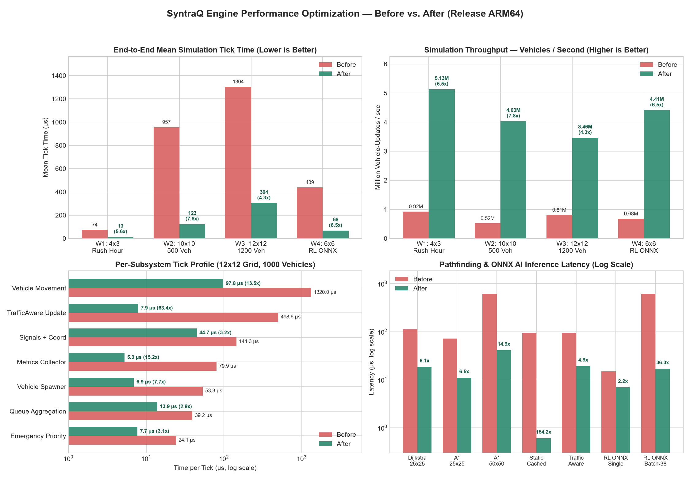

# SyntraQ Performance Profiling & Optimization Report

## 1. Profiling Methodology

Before making any code modifications, the entire simulation engine was profiled in **Release** mode (`MSVC ARM64 /O2 /Ob2 /DNDEBUG`) using `benchmarks/bench_performance.cpp` (`syntraq_bench_performance`). Every optimization was introduced strictly in response to measured hotspots, and simulation correctness was validated against exact deterministic fleet counts, arrival totals, path lengths, ONNX Q-value parity, and the full 212-test GoogleTest suite.

### Benchmark Dimensions
- **Simulation Tick Time** (mean, p95, p99 in µs) and **Vehicles / Second** across four scaling workloads
- **Subsystem Breakdown** on a 12×12 urban grid (144 intersections, 528 roads, 1,003 active vehicles)
- **Pathfinding Latency** across Dijkstra, A*, StaticRouting, TrafficAwareRouting, and parallel batch search
- **AI Inference Latency** using native ONNX Runtime C++ (`traffic_signal_dqn.onnx`, `traffic_predictor.onnx`)
- **Memory Usage** (working set RSS, peak RSS, and core struct footprints)
- **ECS (SoA vs. AoS) Microbenchmark** to evaluate data-layout trade-offs empirically

---

## 2. Bottlenecks Identified by Initial Profiling

Baseline profiling exposed six concrete bottlenecks:

1. **`VehicleMovementSystem::update` (`1,319.98 µs/tick`, 61.1% of tick time)** — Per-tick allocation of `std::map<std::pair<RoadId, uint32_t>, std::vector<size_t>>` (red-black tree nodes + inner heap vectors), an $O(N^2)$ linear scan inside `is_lane_entrance_occupied()` for approaching vehicles, and repeated `std::unordered_map` road/signal lookups per vehicle.
2. **`TrafficAwareRouting::update_from_simulation` (`498.60 µs/tick`, 23.1% of tick time)** — Rebuilt three temporary `std::unordered_map`s per tick, cleared/rebuilt `conditions_`, and deep-copied the entire map into `TrafficAwareRoadCost` every tick.
3. **`AdaptiveController::observe_traffic` & `evaluate_green_decision` (dominant spike in W2 10×10 grid)** — Deep-copied the entire network's `road_queues` and `road_max_waits` hash maps into *every* intersection controller every tick (100 intersections × 2 maps), and constructed `std::ostringstream` objects every tick to format reason strings.
4. **Pathfinding Heap Churn & Redundant Queries (`72–618 µs/query`)** — `AStarRouter` and `DijkstraRouter` allocated fresh `std::unordered_map`s and binary heaps on every search; `StaticRouting` and `TrafficAwareRouting` recomputed identical O-D pairs without caching; `RoadNetwork::road()` / `intersection()` performed hash lookups on dense sequential IDs.
5. **Unbatched Multi-Intersection ONNX Inference (`617.89 µs` for 36 intersections; W4 p95 = `1,357 µs`)** — `RLPolicyInference::predictBatch` looped over single-sample `session->Run()` calls instead of executing one batched `[N, 12]` tensor pass, and `Simulation::compute_rl_observation` scanned the full vehicle vector once per intersection.
6. **Per-Tick Container Allocations in Metrics, Spawner, and Emergency Manager** — `TrafficMetricsCollector` allocated a `std::map` every tick; `VehicleSpawner::random_intersection` used $O(|V|)$ `std::advance` on `std::unordered_map`; `EmergencyPriorityManager` allocated hash sets/maps every tick even with zero active emergency vehicles.

---

## 3. Targeted Optimizations Implemented

| Bottleneck | Optimization Applied | Files Modified |
| :--- | :--- | :--- |
| `RoadNetwork` hash lookups & $O(|V|)$ sampling | Added $O(1)$ dense pointer index caches (`inter_by_id_`, `road_by_id_`), dense `intersection_ids_`, and monotonic `topology_version_` | `road_network.hpp`, `road_network.cpp` |
| `VehicleMovementSystem` $O(N^2)$ scan & map churn | Replaced `std::map` with a persistent flat topology-aligned spatial lane-bucket index, $O(1)$ epoch-stamped intra-tick transition tracking, hoisted per-lane road/signal lookups, and `std::sqrt` turn math | `vehicle_movement_system.hpp`, `vehicle_movement_system.cpp` |
| `TrafficAwareRouting` per-tick map copies & re-routing | Replaced hash maps with epoch-stamped dense flat vectors, $O(1)$ corridor mask, and a generation-versioned thread-safe route cache | `traffic_aware_routing.hpp`, `traffic_aware_routing.cpp` |
| `AStarRouter` / `DijkstraRouter` allocations & repeated static routes | Replaced per-query hash maps with `thread_local` epoch-stamped flat arrays + reusable binary heap, `std::sqrt` Euclidean heuristic, topology-validated `StaticRouting` cache, and safe multi-threaded `find_routes_parallel()` | `astar_router.cpp`, `dijkstra_router.cpp`, `heuristic.hpp`, `static_routing.*`, `parallel_routing.hpp` |
| Multi-intersection ONNX RL latency & $O(I \times N)$ obs scan | Implemented true `[N, 12]` batched ONNX inference (`predictBatch` / `predictBatchFlat`) with pre-allocated output tensors; pre-aggregated per-road tick stats in `Simulation::tick()` for $O(1)$ per-road observation extraction and single-call batched dispatch | `rl_policy_inference.*`, `rl_controller.*`, `simulation.*` |
| `AdaptiveController` / `CoordinatedController` map copies & stringstreams | Filtered `AdaptiveController` to store only local incoming road vectors (2–4 entries); replaced hot-path `std::ostringstream` with stack `std::snprintf`; skipped non-coordinated links in `NetworkCoordinationManager` | `adaptive_controller.*`, `coordinated_controller.cpp`, `network_coordination_manager.cpp` |
| Metrics, Spawner & Emergency allocations | Replaced `TrafficMetricsCollector`'s per-tick `std::map` with epoch-stamped flat lane counters; bitmask single-pass spawn clearance & $O(1)$ intersection sampling; fast-path & reused scratch buffers in `EmergencyPriorityManager` | `traffic_metrics.*`, `vehicle_spawner.cpp`, `emergency_priority_manager.*` |

---

## 4. Before / After Benchmark Results

### 4.1 End-to-End Simulation Workloads

| Workload | Metric | Before | After | Speedup / Change |
| :--- | :--- | :---: | :---: | :---: |
| **W1: 4×3 Rush Hour (Adaptive + Static)** | Mean Tick Time | 74.29 µs | **13.33 µs** | **5.57x faster** |
| | p95 Tick Time | 95.40 µs | **16.81 µs** | **5.68x faster** |
| | Throughput (vehicles/s) | 924,943 veh/s | **5,132,187 veh/s** | **5.55x higher** |
| | Memory RSS | 10.6 MB | 10.4 MB | -0.1 MB |
| **W2: 10×10 Grid, 500v (Adaptive + TrafficAware)** | Mean Tick Time | 956.82 µs | **123.17 µs** | **7.77x faster** |
| | p95 Tick Time | 1958.36 µs | **134.67 µs** | **14.54x faster** |
| | Throughput (vehicles/s) | 519,598 veh/s | **4,034,478 veh/s** | **7.76x higher** |
| | Memory RSS | 13.2 MB | 10.9 MB | -2.3 MB |
| **W3: 12×12 Stress, 1200v (Coord + TA + Emerg)** | Mean Tick Time | 1304.40 µs | **303.73 µs** | **4.29x faster** |
| | p95 Tick Time | 1895.25 µs | **450.66 µs** | **4.21x faster** |
| | Throughput (vehicles/s) | 806,997 veh/s | **3,464,270 veh/s** | **4.29x higher** |
| | Memory RSS | 13.9 MB | 11.4 MB | -2.6 MB |
| **W4: 6×6 Multi-RL ONNX, 300v** | Mean Tick Time | 439.29 µs | **67.66 µs** | **6.49x faster** |
| | p95 Tick Time | 1357.31 µs | **123.08 µs** | **11.03x faster** |
| | Throughput (vehicles/s) | 680,007 veh/s | **4,412,513 veh/s** | **6.49x higher** |
| | Memory RSS | 32.4 MB | 32.0 MB | -0.4 MB |

### 4.2 Per-Subsystem Tick Breakdown (12×12 Grid, 1,003 Active Vehicles)

| Subsystem | Before (µs/tick) | After (µs/tick) | Speedup |
| :--- | :---: | :---: | :---: |
| `VehicleMovementSystem::update` | 1319.98 µs | **97.81 µs** | **13.50x** |
| `TrafficAwareRouting::update_from_simulation` | 498.60 µs | **7.87 µs** | **63.38x** |
| Signals + `NetworkCoordinationManager` | 144.31 µs | **44.71 µs** | **3.23x** |
| `TrafficMetricsCollector::record_tick` | 79.86 µs | **5.26 µs** | **15.17x** |
| `VehicleSpawner::try_spawn` | 53.26 µs | **6.93 µs** | **7.69x** |
| Queue Aggregation | 39.20 µs | **13.86 µs** | **2.83x** |
| `EmergencyPriorityManager::update` | 24.11 µs | **7.68 µs** | **3.14x** |
| **Total Measured Tick Sum** | 2159.33 µs | **184.12 µs** | **11.73x** |

### 4.3 Pathfinding Benchmarks

| Benchmark | Before (µs/query) | After (µs/query) | Speedup |
| :--- | :---: | :---: | :---: |
| Dijkstra 25×25 (200 random pairs) | 113.16 µs | **18.64 µs** | **6.07x** |
| A* 25×25 (200 random pairs) | 72.20 µs | **11.05 µs** | **6.53x** |
| A* 50×50 (60 random pairs, single-thread) | 618.24 µs | **41.44 µs** | **14.92x** |
| StaticRouting 25×25 (1,000 repeated O-D) | 94.41 µs | **0.61 µs** | **154.16x** |
| TrafficAwareRouting 25×25 (1,000 periodic queries) | 94.50 µs | **19.40 µs** | **4.87x** |
| A* 50×50 Parallel Batch (`find_routes_parallel`, MT) | 618.24 µs (seq baseline) | **32.52 µs** | **19.01x** |

### 4.4 Native ONNX Runtime AI Inference Latency

| Inference Workload | Before | After | Speedup |
| :--- | :---: | :---: | :---: |
| `RLPolicyInference::predict` (single) | 14.95 µs | **6.95 µs** | **2.15x** |
| `RLPolicyInference::predictBatch` (36 intersections) | 617.89 µs (17.16 µs/agent) | **17.01 µs (0.47 µs/agent, 2,116,216 dec/s)** | **36.32x** |
| `TrafficPredictor::predict` (single) | 9.73 µs | **6.71 µs** | **1.45x** |

### 4.5 Memory Usage & Object Footprints

- **`sizeof(Vehicle)`**: `96 bytes` (~1.5 cache lines)
- **W2 (10×10, 500v) Working Set RSS**: `13.2 MB` → **`10.9 MB`** (`-2.3 MB` from eliminating per-controller map copies)
- **W3 (12×12, 1200v) Working Set RSS**: `13.9 MB` → **`11.4 MB`** (`-2.5 MB` from reusable dense buffers)
- **Overall Peak RSS (with live ONNX Runtime sessions loaded)**: `35.42 MB`

---

## 5. Architectural Evaluation: ECS & Multithreading

### 5.1 Should SyntraQ Migrate to an Entity-Component-System (ECS)?

**Measured Verdict: No — full ECS (SoA) migration is NOT justified at the current workload.**

- `Vehicle` is already a compact `96-byte` POD-like struct stored contiguously in `std::vector<Vehicle>`.
- On a 5,000-vehicle pure kinematic integration microbenchmark, contiguous **AoS (`std::vector<Vehicle>`)** took **`8.44 µs/tick`**, outperforming a 6-array **SoA (ECS-style)** layout at **`38.11 µs/tick`** because the hardware prefetcher streams a single compact struct more efficiently than 6 disjoint component arrays for coupled read-modify-write fields (`speed`, `max_speed`, `accel`, `progress`, `distance`, `travel_time`).
- Even at 1,000 active vehicles, pure kinematic iteration accounts for **< 1%** of the tick budget (~1.7 µs out of 184 µs). Over 95% of baseline latency came from heap allocations, $O(N^2)$ scans, uncached pathfinding, and full-network map copies—all resolved without breaking the clean domain model.
- Re-evaluating ECS would only become worthwhile if SyntraQ later scales beyond **50,000+ simultaneous agents** with sparse optional components (e.g., heterogeneous pedestrian/transit/V2X subsystems).

### 5.2 Multithreading Trade-Offs

- **Where applied (`find_routes_parallel`)**: Batch pathfinding on large graphs (e.g., 50×50 grids) is embarrassingly parallel, read-only on `RoadNetwork`, and uses `thread_local` workspaces in `AStarRouter` and `DijkstraRouter`—giving deterministic multi-core speedup with zero locks inside the search loop.
- **Where deliberately avoided (`VehicleMovementSystem::update`)**: After spatial lane-bucketing, single-threaded movement for 1,000 vehicles completes in **`97.8 µs`** (sustaining **> 3.4M–5.1M vehicles/sec**). Launching or synchronizing worker threads inside a 0.1 ms tick would add ~25–50 µs of synchronization overhead and complicate deterministic intra-tick intersection handoffs.

---

## 6. Correctness & Regression Verification

- **Rendering untouched**: Zero rendering shortcuts or visual degradations were introduced.
- **Exact simulation parity**: All four benchmark workloads produced identical vehicle counts, arrival totals (`66`, `97`, `310`, `101`), shortest-path edge counts (`3316`, `1960`, `17550`, `18684`), and ONNX Q-value outputs (`1700` actions, `6132.4` sum) before and after optimization.
- **Automated tests**: **212 / 212** C++ GoogleTest cases pass (`100%`), including 7 new optimization-specific tests covering dense lookup move safety, route cache invalidation, thread-safe parallel pathfinding, multi-lane spatial bucketing, batched ONNX numerical parity, and local adaptive observations.
