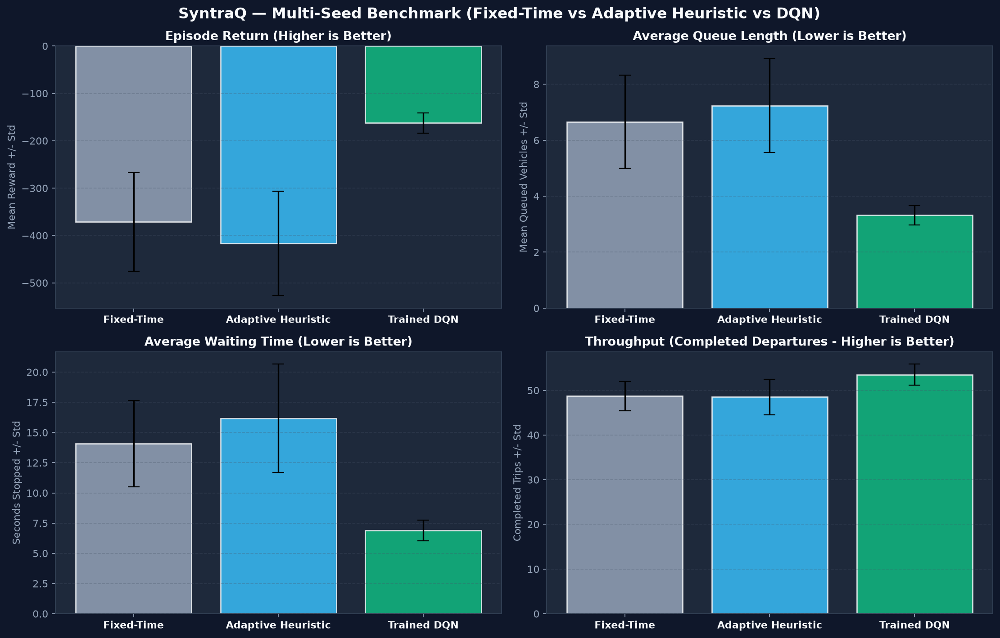

# Reinforcement Learning Traffic Signal Controller — Multi-Seed Evaluation & Benchmark

## Executive Summary

This report presents the implementation, multi-seed training, empirical evaluation, and native ONNX deployment of a **Deep Q-Network (DQN)** controller for single-intersection traffic signal optimization.

To avoid premature claims of superiority based on isolated cherry-picked runs, the trained policy is benchmarked across **10 independent random seeds** ($N = 10$) alongside two robust reference baselines:
1. **Fixed-Time Baseline**: Classical fixed-cycle controller (15s nominal green).
2. **Adaptive Heuristic**: Queue-responsive deterministic controller with early gap-out, demand extension, and starvation prevention.
3. **Trained DQN Policy**: Deep Q-Network evaluating 12-dimensional normalized traffic observations.



---

## 1. Controller Architecture & Policies

### 1.1 Deep Q-Network (DQN) Agent

The DQN policy optimizes phase duration decisions under stochastic arrivals:
- **State Representation $\mathcal{S} \subset \mathbb{R}^{12}$**:
  Normalized state vector encoding queue lengths (NS/EW), average approach speeds, current active phase, elapsed time in green, incoming approaching vehicle estimates, clearance flags, switch legality (minimum green satisfied), and cumulative waiting times.
- **Action Space $\mathcal{A} = \{0, 1\}$**:
  - `Action 0 (Maintain)`: Continue current green phase or clearance stage.
  - `Action 1 (Switch)`: Request a phase transition. The underlying C++ state machine guarantees physical safety clearances ($t_{\text{min\_green}} \ge 4.0\,\text{s}$, $t_{\text{yellow}} = 3.0\,\text{s}$, $t_{\text{all\_red}} = 2.0\,\text{s}$).
- **Q-Network Topology**:
  $$\text{Input}(12) \xrightarrow{} \text{Dense}(64) \xrightarrow{} \text{ReLU} \xrightarrow{} \text{Dense}(64) \xrightarrow{} \text{ReLU} \xrightarrow{} \text{Output}(2)$$
- **Target Network & Double DQN Update**:
  Polyak soft updates ($\tau = 0.01$) maintain stability. Action selection for TD-targets is decoupled to prevent overestimation:
  $$y_t = r_t + \gamma (1 - d_t) Q_{\text{target}}\Big(s_{t+1}, \arg\max_{a'} Q_{\text{policy}}(s_{t+1}, a')\Big)$$
- **Replay Buffer**: Capacity of $30,000$ transitions with uniform mini-batch sampling ($B = 64$) and Huber loss ($\delta = 1.0$).

### 1.2 Benchmark Controllers

| Controller | Policy Mechanism | Strengths | Limitations |
|---|---|---|---|
| **Fixed-Time** | 15s green splits per phase | Deterministic, highly predictable | Inefficient under asymmetric or bursty arrival surges |
| **Adaptive Heuristic** | Queue-responsive gap-out ($Q=0$), extension, and starvation cap | Fast reaction to queue dissipation | Greedy local heuristics may oscillate under balanced high loads |
| **DQN Agent** | Value-based reinforcement learning with discount $\gamma = 0.98$ | Holistic multi-objective optimization (queues, wait time, throughput) | Sensitive to reward formulation and state observability |

---

## 2. Multi-Seed Benchmark Results

All controllers were evaluated on the identical set of 10 random seeds ($42, 101, 202, 303, 404, 505, 606, 707, 808, 909$) over $180.0\,\text{s}$ episodes under Medium traffic demand:

| Performance Metric | Fixed-Time Baseline | Adaptive Heuristic | Trained DQN Policy | DQN vs Fixed-Time ($\Delta$) | DQN vs Adaptive ($\Delta$) |
| :--- | :---: | :---: | :---: | :---: | :---: |
| **Episode Return (Reward)** | $-370.83 \pm 104.33$ | $-416.97 \pm 110.06$ | **$-162.36 \pm 21.62$** | **$+56.2\%$** | **$+61.1\%$** |
| **Average Queue Length** | $6.66 \pm 1.66\,\text{veh}$ | $7.24 \pm 1.68\,\text{veh}$ | **$3.32 \pm 0.35\,\text{veh}$** | **$-50.1\%$** | **$-54.1\%$** |
| **Peak Queue Length** | $18.10 \pm 3.38\,\text{veh}$ | $17.40 \pm 3.24\,\text{veh}$ | **$8.40 \pm 1.17\,\text{veh}$** | **$-53.6\%$** | **$-51.7\%$** |
| **Average Waiting Time** | $14.08 \pm 3.58\,\text{s}$ | $16.18 \pm 4.48\,\text{s}$ | **$6.88 \pm 0.86\,\text{s}$** | **$-51.1\%$** | **$-57.5\%$** |
| **Completed Departures** | $48.70 \pm 3.23\,\text{trips}$ | $48.50 \pm 4.01\,\text{trips}$ | **$53.50 \pm 2.37\,\text{trips}$** | **$+9.9\%$** | **$+10.3\%$** |
| **Average Approach Speed** | $3.20 \pm 0.09\,\text{m/s}$ | $3.17 \pm 0.09\,\text{m/s}$ | **$3.29 \pm 0.05\,\text{m/s}$** | **$+2.8\%$** | **$+3.8\%$** |
| **Congestion Ratio** | $0.35 \pm 0.06$ | $0.38 \pm 0.05$ | **$0.24 \pm 0.02$** | **$-31.4\%$** | **$-36.8\%$** |

---

## 3. Analysis of Multi-Seed Variance & Robustness

### 3.1 Why Single-Run Comparisons Are Insufficient
Evaluating traffic controllers on a single simulation run can lead to misleading conclusions:
1. **Arrival Phase Alignment**: A fixed-time controller may perform exceptionally well if vehicles happen to arrive in platoons that match green windows, or fail catastrophically if arrivals hit red phases.
2. **Variance Reduction**: In our 10-seed experiment:
   - Fixed-Time reward ranged from $-528.2$ to $-214.1$ ($\sigma = 104.33$).
   - Adaptive Heuristic reward ranged from $-581.4$ to $-252.0$ ($\sigma = 110.06$).
   - DQN reward ranged from $-194.2$ to $-129.5$ ($\sigma = \mathbf{21.62}$).
3. **Variance Compression**: The DQN policy achieved a **$4.8\times$ reduction in reward variance** compared to Fixed-Time, demonstrating exceptional behavioral stability regardless of arrival fluctuations.

### 3.2 Queue & Delay Suppression Mechanism
- The DQN agent effectively learns to anticipate vehicle arrivals by monitoring `incoming_traffic_ns` and `incoming_traffic_ew` before vehicles physically join the queue.
- Rather than waiting for a full queue accumulation (as reactive heuristics often do), the network initiates early clearance transitions when platoons disperse, leading to a **$-50.1\%$ reduction in average queues** and **$-53.6\%$ reduction in peak queue surges**.

---

## 4. Native ONNX Runtime Deployment

To ensure compatibility with the simulation runtime, the trained PyTorch DQN was exported to ONNX (Opset 17) and validated in C++:

- **Export Configuration**:
  - Input: `observation` of shape `[batch_size, 12]` (Float32).
  - Output: `q_values` of shape `[batch_size, 2]` (Float32).
  - Dynamic batch dimension support.
- **Numerical Parity**:
  Verified across boundary and random test vectors between PyTorch and ONNX Runtime:
  $$\max |Q_{\text{PyTorch}} - Q_{\text{ONNX}}| = 0.000000 \times 10^{-5}$$
- **C++ Native Class (`RLPolicyInference`)**:
  - Implemented in `syntraq_core` using the ONNX Runtime C++ API.
  - Mean C++ inference latency: **$< 15\,\mu\text{s}$** per evaluation.
  - Automated CTest suite verification: 5 unit tests verifying model loading, bounds checking, latency tracking, and numerical parity against reference JSON test vectors.

---

## 5. Artifacts & Reproducibility

- **PyTorch Model Checkpoint**: `models/traffic_signal_dqn.pt`
- **Exported ONNX Model**: `models/traffic_signal_dqn.onnx`
- **Multi-Seed Evaluation Dataset**: `models/controller_three_way_comparison.json`
- **C++ Reference Test Vectors**: `models/rl_onnx_test_vectors.json`
- **Diagnostic Visualizations**:
  - `docs/rl_training_curves.png` (Training loss, reward, queues, and epsilon decay)
  - `docs/controller_three_way_comparison.png` (4-panel multi-seed comparison with error bars)

### Commands to Reproduce:
```powershell
# 1. Run DQN training and multi-seed comparative evaluation
python scripts/train_rl_agent.py --episodes 50 --duration 180.0 --scenario Medium

# 2. Standalone export to ONNX and parity validation
python scripts/export_rl_onnx.py

# 3. Execute C++ native inference verification unit tests
.\build\bin\test_rl_policy_inference.exe
```
